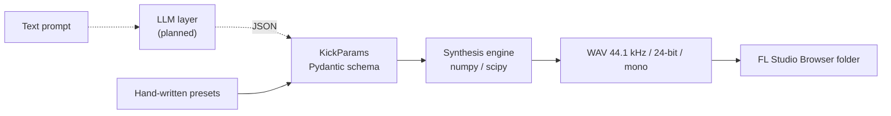

# KickGen

Describe a kick drum in plain text, get WAV files ready to drop into FL Studio.

> "short dry techno kick, 50 Hz" → `techno_kick_01.wav` (+ the JSON parameters that produced it)

An LLM translates the description into **synthesis parameters** validated by a
schema; a deterministic DSP engine turns those parameters into audio. The LLM
never generates audio directly, so every sound is reproducible and editable.

## Status

Early development. Only what is checked below works today.

| Step | Scope | Status |
| --- | --- | --- |
| 1 | Synthesis engine + 24-bit WAV export + 5 hand-written presets | ✅ done |
| 2 | CLI and replayable JSON parameters | ⏳ |
| 3 | LLM layer: text → parameters, schema validation, retries | ⏳ |
| 4 | Variations and iteration ("shorter", "more punch") | ⏳ |
| 5 | Automatic evaluation on a reference set | ⏳ |
| 6 | Web UI + audio demo | ⏳ |

## Architecture



Signal chain of the engine (`src/kickgen/synth.py`):

1. **Body**: sine oscillator with an exponential pitch sweep
   `f(t) = end + (start - end) · exp(-t / τ)`. The phase uses the closed-form
   integral of the sweep, so the tail lands exactly on the target pitch.
2. **Amplitude envelope**: linear attack, hold, exponential decay.
3. **Click**: band-passed white noise with a fast decay (seeded, deterministic).
4. **Distortion**: `tanh` saturation or hard clipping.
5. **Low-pass filter**: 4th-order Butterworth.
6. **5 ms end fade** (no click at the end of the sample) and **peak normalisation**.

## Quick start

```bash
python -m venv .venv && source .venv/bin/activate
pip install -e ".[dev]"
pytest
python scripts/render_presets.py output/presets
```

Then add `output/presets` to FL Studio's Browser (*Options → File settings →
Browser extra search folders*) and drag a kick into the Channel Rack.

```python
from kickgen import KickParams, export_kick

params = KickParams(
    name="my_kick",
    duration_s=0.4,
    pitch={"start_hz": 300, "end_hz": 50, "decay_s": 0.03},
    distortion={"amount": 0.3},
)
export_kick(params, "my_kick.wav")
```

## Presets

| Preset | Character |
| --- | --- |
| `techno_tight` | short, dry, settles at 50 Hz |
| `808_long_F` | long sub tail tuned to F1 (43.65 Hz) |
| `hardstyle_distorted` | hard-clipped, long tail |
| `lofi_soft` | no click, low-passed at 1.2 kHz |
| `house_punchy` | punchy, warm saturation |

## Design choices

- **Parameters, not audio, from the LLM.** Bounded, typed parameters
  (`extra="forbid"`, min/max on every field) make LLM output checkable and
  the audio 100 % reproducible.
- **Nested schema** (`pitch`, `amp`, `click`, `distortion`, `filter`) mirrors
  the signal chain, which keeps the JSON readable for both humans and models.
- **Tests check the sound, not just the code**: the tail's fundamental is
  measured by FFT, the click must raise the spectral centroid, distortion must
  lower the crest factor.

## Limitations

- Mono, single-oscillator design: no layered tops or sampled transients yet.
- Presets were designed from synthesis parameters and checked with audio
  metrics; the listening test in FL Studio is still to be done.

## License

MIT
